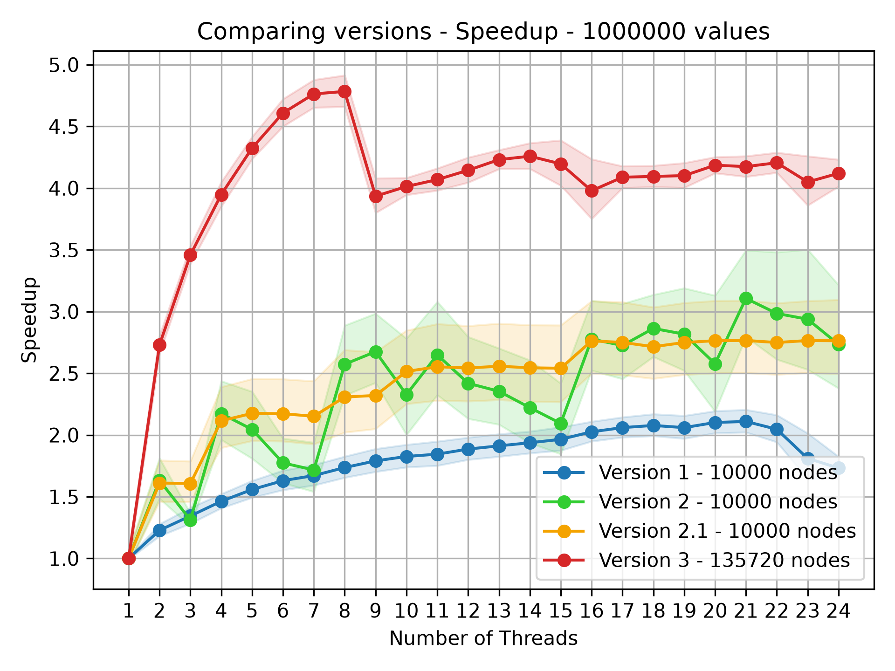
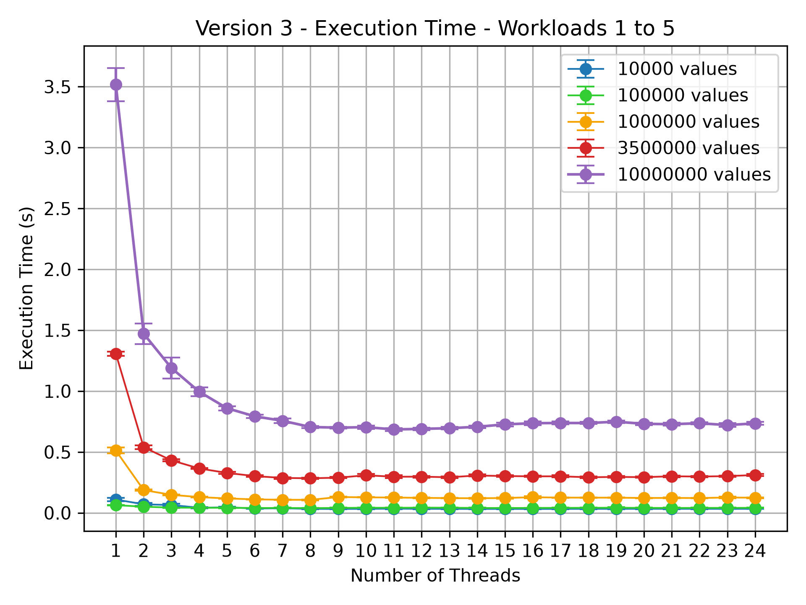
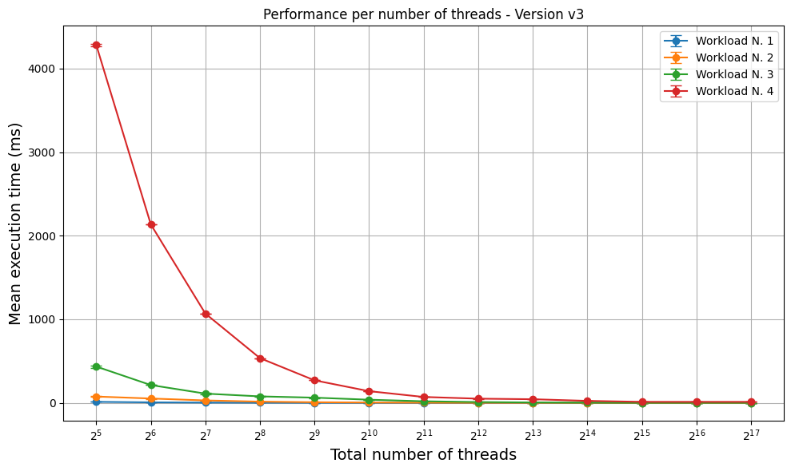
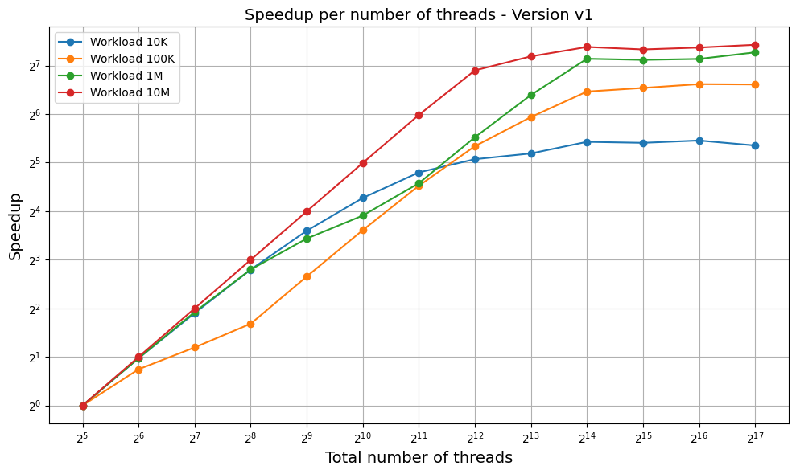

# CPU/GPU Bottleneck Analysis: Parallel Search in a Binary Search Tree

**CPU (POSIX threads) and GPU (CUDA) implementations, optimized step by step and benchmarked.**

Project work for the *Computer Architecture* course — Master's Degree in Computer Engineering.
Authors: **Alessio Simoncini**, **Gabriele Caioli**.

A binary search tree (left child < parent < right child, no duplicates) is built from a vector of values; then a much larger
vector of values is searched in it, and for each value the program reports whether it is in the tree. The goal is to search as many
values per second as possible, first on a multicore CPU and then on a GPU, profiling each version to find the bottleneck to remove
in the next one.

| Phase | Hardware | Goal | Best result |
|---|---|---|---|
| CPU | Intel Core i5 10th gen (4 cores / 8 threads) | 11 M values/s | **14.2 M values/s** (Version 3, 8 threads) |
| GPU | NVIDIA Tesla T4 (40 SMs) on Google Colab | 1 G values/s | **1.035 G values/s** (Version 3, 40,960 threads) |

The full analysis is in the [presentation](docs/cpu_gpu_bottleneck_analysis_slides.pdf), which covers both phases.

---

## Versions

### CPU (`src/cpu/`)

| Version | Idea | Bottleneck found by profiling (Intel VTune) |
|---|---|---|
| **V1** – dispatcher ([`v1_dispatcher`](src/cpu/v1_dispatcher)) | One persistent worker per subtree at level log2(N). The main thread walks the top of the tree for each value and hands the search to the worker owning that subtree (mutex + condition variables). | The main thread waits whenever consecutive values fall in the same subtree: the searches are effectively serialized. |
| **V2** – range split ([`v2_range_split`](src/cpu/v2_range_split)) | Before searching, the input is split into one sub-vector per thread according to the range of values of its subtree; each thread works independently on its own subtree. An extra thread handles the values that stop in the top levels. | The tree is not balanced: a thread's load depends on how many values fall in its subtree. |
| **V2.1** | Same code as V2, run only with power-of-two thread counts (`benchmark_cpu.py v2_1`). | |
| **V3** – equal split ([`v3_equal_split`](src/cpu/v3_equal_split)) | The input is logically split into equal parts (thread *i* takes indices *i*, *i+N*, *i+2N*, …) and every thread starts from the root. No ranges or subtrees to compute, balanced load. | |

### GPU (`src/gpu/`)

All GPU versions use the algorithm of CPU Version 3: every CUDA thread takes values with a grid-stride loop and walks the tree from the root.

| Version | Tree representation | Bottleneck found by profiling (Nsight Compute) |
|---|---|---|
| **V1** ([`v1_pointer_tree.cu`](src/gpu/v1_pointer_tree.cu)) | Pointer-based tree copied to the GPU node by node (24 B/node). | Scattered nodes: non-coalesced accesses, L1 hit rate 71%, low memory throughput. |
| **V2.1** ([`v2_1_indexed_array.cu`](src/gpu/v2_1_indexed_array.cu)) | Contiguous array of structs, children stored as indices (12 B/node). | Better L1 hit rate (80%), but still many global memory requests. |
| **V2.2** ([`v2_2_implicit_array.cu`](src/gpu/v2_2_implicit_array.cu)) | Tree rebalanced on the CPU, then stored as an implicit array in breadth-first order: children of *i* at *2i+1* and *2i+2* (4 B/node, −83%). | Each step depends on a value read from slow global memory; not all theoretical warps are used. |
| **V3** ([`v3_shared_memory.cu`](src/gpu/v3_shared_memory.cu)) | Same implicit array, copied to `__constant__` memory and from there into the **shared memory** of every block. The 8,190-node tree (~2^13 × 4 B = 32 KB) fits in a block's shared memory. | Global memory and warp occupancy problems solved. |

---

## Results

### CPU

Mean wall-clock time of the whole program and throughput at 8 threads, computed from [`results/cpu`](results/cpu) (30 runs per point):

| Version | Values searched | Time @ 8 threads | Throughput @ 8 threads |
|---|---|---|---|
| V1 | 1 M | 8.26 s | 0.12 M values/s |
| V2 | 10 M | 1.09 s | 9.2 M values/s |
| V3 | 10 M | 0.71 s | **14.2 M values/s** |





All the CPU graphs are in [`results/cpu/graphs`](results/cpu/graphs).

### GPU

Kernel time and throughput on 10 M values (from the GPU presentation):

| Version | Time @ 2^15 threads | Throughput @ 2^15 threads |
|---|---|---|
| V1 | 47.4 ms | 211.0 M values/s |
| V2.1 | 38.9 ms | 257.3 M values/s |
| V2.2 | 19.0 ms | 526.3 M values/s |
| V3 | 12.07 ms | 828.5 M values/s |
| V3 @ 40,960 threads (40 SMs × 1024, full occupancy) | 9.66 ms | **1,035 M values/s** |





All the GPU graphs are in [`results/gpu/graphs`](results/gpu/graphs). The raw GPU measurements are not included in the
repository; [`scripts/plot_gpu_results.py`](scripts/plot_gpu_results.py) regenerates every graph from them.

---

## Repository structure

```
.
├── include/                 Shared headers (binary tree, dataset)
├── src/
│   ├── common/bintree.c     Binary search tree (insert, search, extract, print)
│   ├── cpu/
│   │   ├── v1_dispatcher/   CPU Version 1
│   │   ├── v2_range_split/  CPU Version 2 (and 2.1)
│   │   └── v3_equal_split/  CPU Version 3
│   └── gpu/                 GPU versions 1, 2.1, 2.2, 3 + shared host helpers and main
├── scripts/
│   ├── generate_dataset.py  Generates the input data compiled into the executables
│   ├── benchmark_cpu.py     Runs the CPU benchmarks  -> results/cpu/*.json
│   ├── plot_cpu_results.py  CPU graphs               -> results/cpu/graphs/
│   ├── benchmark_gpu.py     Runs the GPU benchmarks  -> results/gpu/*.json
│   └── plot_gpu_results.py  GPU graphs               -> results/gpu/graphs/
├── notebooks/gpu_colab.ipynb   Build, benchmark, profile and plot the GPU versions on Google Colab
├── results/                 Measurements and graphs
├── docs/cpu_gpu_bottleneck_analysis_slides.pdf   Presentation of the project (both phases)
└── Makefile
```

---

## Build and run

Requirements: a C compiler, `make`, Python 3 (Linux or macOS). The GPU versions also need the CUDA toolkit (`nvcc`)
and an NVIDIA GPU — the easiest way is [Google Colab](notebooks/gpu_colab.ipynb).

```bash
make                 # CPU versions -> bin/cpu_v1, bin/cpu_v2, bin/cpu_v3
make gpu             # GPU versions -> bin/gpu_v1, bin/gpu_v2_1, bin/gpu_v2_2, bin/gpu_v3
```

CPU Versions 2/3 and all GPU versions read their input from a dataset that is generated by
[`scripts/generate_dataset.py`](scripts/generate_dataset.py) and compiled into the executable, so that every version is measured
on exactly the same values. The default dataset (500,000 values to insert, 10,000,000 to search) takes a couple of minutes to
generate and compile; a smaller one is enough to try things out:

```bash
make SEED=1 NODES=50000 QUERIES=1000000
```

### Command-line arguments

```bash
# CPU Version 1 (generates its values at runtime from SEED, in [MIN, MAX])
./bin/cpu_v1 <NUM_THREADS> <NUM_NODES> <NUM_TO_SEARCH> <SEED> <MIN> <MAX> <TO_EXTRACT> <VERBOSE>
./bin/cpu_v1 8 10000 1000000 42 10000 99999 0 0

# CPU Versions 2 and 3
./bin/cpu_v3 <NUM_THREADS> <NUM_NODES> <NUM_TO_SEARCH> <TO_EXTRACT> <VERBOSE>
./bin/cpu_v3 8 50000 1000000 0 0

# GPU versions (prints the timing breakdown)
./bin/gpu_v3 <THREADS_PER_BLOCK> <NUM_BLOCKS> <NUM_NODES> <NUM_TO_SEARCH> <TO_EXTRACT> <VERBOSE> <VERBOSE_TIMES> <REPETITIONS>
./bin/gpu_v3 1024 32 8190 1000000 0 0 1 1
```

`NUM_NODES` and `NUM_TO_SEARCH` must not exceed the size of the dataset the executable was built with.

---

## Benchmarks and graphs

```bash
pip install -r requirements.txt

# CPU: 1..24 threads, 30 seeds, the workloads of the published results (takes hours with the defaults)
python3 scripts/benchmark_cpu.py v3
python3 scripts/benchmark_cpu.py v3 --seeds 5 --max-threads 8 --nodes 10000 --queries 100000 1000000   # quick run
python3 scripts/plot_cpu_results.py

# GPU (on a machine with an NVIDIA GPU, e.g. Colab)
python3 scripts/benchmark_gpu.py --versions v1 v2_1 v2_2 --threads-per-block 32
python3 scripts/benchmark_gpu.py --versions v3 --threads-per-block 1024
python3 scripts/plot_gpu_results.py
```

Methodology:

- Every configuration is run once per seed (30 seeds → 30 different datasets) and the graphs show the mean with its 95%
  confidence interval (Student's t).
- CPU times are the wall-clock time of the whole process (tree construction included), measured by the benchmark script.
- GPU times are the kernel time (`SEARCH` in the timing breakdown printed by each executable). Workloads larger than the dataset
  are obtained by searching the whole dataset multiple times.
- The `Makefile` defaults reproduce the build used for the measurements: no compiler optimizations for the CPU code and
  `-G` (device debug info) for the CUDA code. Override `CFLAGS` / `NVCCFLAGS` (e.g. `make CFLAGS="-O2 -Wall"`) to experiment.
